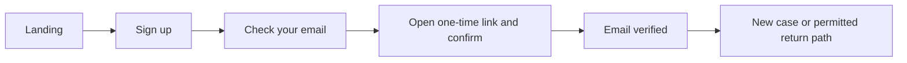
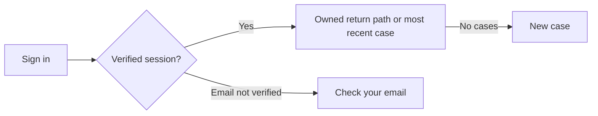
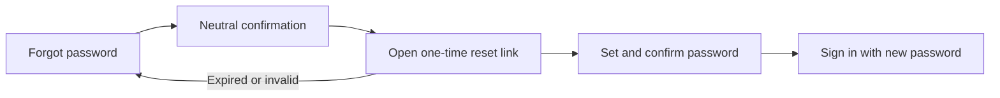
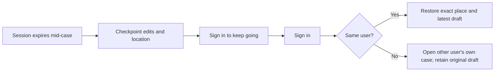

# Tenant Shield Auth UI Specification

Approved auth specification, now implemented with the local demo backend.
See AUTH-IMPLEMENTATION.md for runtime verification and demo instructions.
Read MASTER.md and SCREENS.md with this extension.
AUTH.md supersedes the older "No auth" and public-case/demo entry assumptions.
DATA.md defines storage, ownership, sessions, and the Supabase adapter boundary.

## Design and skill evidence

Retain navy #101F2A, green #176F5A, mint #E7F2EC, canvas #F7F9F8, ink #172B33,
muted #52656D, white surfaces, DM Sans body, and Manrope headings. No new colors
or fonts. Auth errors, lockouts and deletion use navy + icon + full text; red
remains exclusive to the case verdict Likely not allowed.

UI/UX Pro Max searches run for this task:
- ux "accessible authentication password managers": Accessible Authentication
  (Minimum), Password Visibility. Apply paste/autofill and visible toggles.
- ux "inline validation password toggle": Inline Validation, Password Visibility,
  Focusable Error Summary. Apply blur validation and associated inline errors.
  User instruction overrides summary-first focus: focus the first invalid field.
- product "legal services onboarding trust": Legal Services -> Accessible & Ethical
  + Minimalism & Swiss Style, Trust & Authority + Minimal. Apply calm hierarchy;
  keep existing brand colors rather than adopt the search's alternate palette.
- ux "onboarding progressive disclosure": User Freedom (tutorial skipping) and
  Heading Line Balance. Useful for avoiding a forced tour, not skipping accounts.
  Narrowed retry "progressive disclosure" returned typography only: no verified
  component-level onboarding match. Do not present that as a relevant auth match.
- stack shadcn "form labels inline errors": FieldError and FieldLabel guidance.
- Reviewed skill quick-reference categories 1–10 and the existing checklist.

No new design-system generation: this extends the approved system, not a new
product-wide direction. Onboarding ends in a case, not a tutorial or dashboard.

## Access and routing

An account and verified email are required for every /case/* path and /account,
including /case/demo. No guest CTA or route bypass. Landing stays public:
primary "Start your case" -> /signup; header "Sign in" -> /login.
A public example preview may stay on Landing, but opening its case requires login.

Auth provider states: initializing, signed_out, pending_verification, signed_in,
recovery_only, expired, storage_error. Show a protected-route placeholder while
resolving; do not briefly render a case address or another user's name.

Signed out -> /login?returnTo=<encoded pathname+query+fragment>. Preserve wizard
step, case tab and in-page location. Accept only normalized same-origin paths
starting /case/ or exactly /account (and approved account subpaths). Reject
absolute URLs, protocol-relative paths, backslashes, control characters, encoded
redirect tricks, auth-loop destinations and unknown paths; fall back safely.
Recheck ownership after login; an inaccessible case shows the same unavailable
state as a missing case. Do not reveal who owns it.

After explicit sign in/sign up verification:
1. Restore a matching-owner recovery checkpoint, if one exists.
2. Otherwise follow a validated explicit returnTo.
3. Otherwise open the signed-in user's most recently updated case.
4. If none exists, /case/new. Never navigate to an empty dashboard.
Creating/visiting auth pages must not mark cases updated or create empty cases.

New signup requires verification. Valid password for an unverified registration
opens Check your email; it does not grant case access. An invalid email/password
combination always gets the same sign-in failure. Signed-in verified users visiting
/login or /signup use the same destination resolver, without a redirect loop.

## Flow diagrams









Readable equivalents: Landing -> signup -> check email -> verify -> case;
login -> recent case/new case; forgot -> confirmation -> reset -> login;
expiry -> checkpoint -> login -> same-owner restoration.

## Shared responsive frame and form contract

Below 1024px: compact logo/header, a single 100% width card with 16px gutters,
normal vertical scroll, footer below form. No signed-out case navigation.
At >=1024px: a navy brand/story column (about 40%) and white/canvas form column;
form maximum 440px, centered, 32px padding. Body measure <=68ch. Mobile form
heading 28/36px; desktop 36/44px. Account settings retain the signed-in app shell.
At 200% zoom, stack columns when effective CSS width requires it. At 320 CSS px
there must be no horizontal scroll or clipped footer, email, requirements, or menu.

Inputs and buttons minimum 48px high; all hit areas >=44x44 CSS px, 8px gaps,
input font 16px. Existing 3px focus ring, 2px offset. Auth submit stays in form
flow so it cannot jump on blur or compete with the keyboard. It may become a
sticky mobile action only if its bounds remain stable and focus is unobscured.
Use existing motion tokens and reduced-motion behavior. No animated progress %.

Every input has a persistent label above it; errors sit below the relevant field
with id/aria-describedby and aria-invalid. Validate on blur and submit, never
show validation errors on each keystroke. If a blurred invalid field changes,
clear its stale error and revalidate on next blur/submit. Do not move focus on
blur. On submit focus the first invalid field in DOM order. A form-wide failure
focuses the error block when there is no invalid field. Announce newly introduced
errors in a single appropriate live region; avoid duplicate alert announcements.

Use native form submission (Enter), native label/checkbox semantics, and logical
tab order. Password toggles are type=button; no Enter interception or paste
blocking. Preserve password-manager behavior when changing type.
- Email: type=email, autocomplete=email, inputmode=email, autocapitalize=none,
  spellcheck=false; trim outer whitespace and normalize lookup consistently.
- Sign in: password autocomplete=current-password.
- Signup/reset: password autocomplete=new-password; confirmation also new-password.
- Name: autocomplete=name.
- No password, confirmation, token, or consent checkbox is persisted as a draft.
- Show toggle label "Show password"/"Hide password"; confirm toggle says
  "Show password confirmation"/"Hide password confirmation".
- Preserve all form values after a validation/request/rate-limit failure. Clear
  secrets only on success, explicit cancellation or leaving the auth flow.
- Loading: synchronous submit latch plus disabled submit and spinner; keep button
  dimensions and its current focus stable. Form aria-busy, one polite status.
  Show/hide and policy links remain available; no second submit request.

Password policy draft: 12–128 Unicode code points, not all whitespace. Spaces,
paste, generated passwords and long passphrases are allowed. No composition
puzzles or forced uppercase/symbol rules. Checklist items: "At least 12 characters",
"128 characters or fewer", "More than spaces". This checklist updates live as
guidance, not field-error validation; announce completed requirements politely,
not every character. Server/local client uses exactly the same policy; never
trim or silently truncate a password.

Near every form, exact requested trust copy:
"Your documents stay private. We never share them with your landlord."
Implementation annotation: // TODO(legal): confirm wording matches the privacy policy
For local backend also show "Local demo: your account and files stay in this browser."
This is not an encryption/security claim. Legal copy must be reviewed before release.

Footer on all auth screens: "Terms · Privacy · Not legal advice."
Links -> /terms and /privacy with readable, clearly marked review drafts until
approved text exists; never dead links, empty dialogs, or invented legal policies.
Keep return navigation when opening/closing policy documents. No case data in URLs.
Production release needs approved policies and a matching trust statement.

OAuth: spec-only secondary outlined button "Continue with Google", Google mark
only from approved assets. It sits above the email form with "or use your email".
It is absent from layout, DOM, tab order and screen readers while
NEXT_PUBLIC_ENABLE_OAUTH=false (default). Even if flag=true, hide it until the
backend actually supports OAuth; no nonfunctional button. No new brand colors
are added to the system. Later OAuth completion uses the same return resolver.

## State wireframe notation

Each screen has full mobile/desktop default frames plus eight state frames below.
The small ASCII fragments replace only the affected region in the full frame:
the surrounding header, supporting text and footer remain present. Thus each
screen/state has both mobile and desktop composition without duplicating a
whole page for every field message. D uses the same form fragment at the right
of the persistent navy brand column. Account screens use the app sidebar instead.

Notation: [ ] empty; [value] filled; [^value] keyboard focused with existing ring;
[!value] invalid with linked error directly below; [~ Action] spinner, disabled,
latched submit; [ok] success icon + text; [lock] timed status. All fragments are
ASCII; the microcopy column contains the full user-facing message.
Confirmation/menu screens have no text-entry field; their focused/filled/error
rows explicitly describe the relevant control/subflow instead of inventing inputs.

## 1 Sign in — /login

Title "Welcome back." Body "Pick up where you left off."
Labels Email, Password. Primary "Sign in"; recovery "Forgot password?";
secondary "New here? Create an account." Optional development demo panel shows
demo@tenantshield.app and the server-provided DEMO_PASSWORD only in development.
"Use demo account" fills fields, never auto-submits. Production includes neither
the panel nor its password in HTML, serialized props, assets or logs.

```text
MOBILE                              DESKTOP
+---------------------------+       +------------------+-------------------------+
| Tenant Shield     Sign up |       | Tenant Shield    | Welcome back.           |
| Welcome back.             |       | Your evidence.   | Email [               ] |
| Email [                 ] |       | Your next step.  | Password [      ][Show] |
| Password [         ][Show]|       | Calm supporting  | Forgot password?        |
| Forgot password?          |       | copy, no metrics | [Sign in]               |
| [Sign in]                 |       | or guarantees.   | Create an account       |
| Create an account         |       |                  | Trust line              |
| Trust line                |       |                  | Dev demo panel (*)      |
| Terms Privacy Legal       |       +------------------+-------------------------+
+---------------------------+       | Terms - Privacy - Not legal advice         |
```

| State | Mobile frame | Desktop frame | Full copy/behavior |
| --- | --- | --- | --- |
| Default | Email [ ] -> Password [ ] -> [Sign in] | Brand / Email [ ] -> Password [ ] -> [Sign in] | No error before interaction. |
| Focused | Email [^ ] -> Password [ ][Show] | Brand / Email [^ ] -> Password [ ][Show] | Label and hint remain; toggle reachable next to password. |
| Filled | Email [entered] -> Password [masked] | Brand / Email [entered] -> Password [masked] | No automatic submit; preserve returnTo. |
| Loading | [~ Signing in...] | Brand / [~ Signing in...] | "Signing you in..." |
| Field error | Email [!value] -> error -> Password [masked] | Brand / Email [!value] -> error | "Enter your email address." / "Enter an email address like name@example.com." / "Enter your password." |
| Form error | [!] -> fields retained -> [Sign in] | Brand / [!] -> retained form | "Email or password is incorrect." Storage failure instead: "We couldn't open your account in this browser. Try again." |
| Success | [ok Signed in] -> destination | Brand / [ok Signed in] -> destination | "You're signed in. Opening your case..." |
| Rate-limited | [lock] -> retained fields -> [Sign in disabled] | Brand / [lock] -> retained form | "Too many attempts. Try again in {X} min." Five failed attempts per normalized email, five-minute lock; timer persists on reload. |

## 2 Sign up — /signup

Title "A place for your case." Body "Create an account to keep your evidence and next steps together."
Fields Name, Email, Password; live password checklist; unchecked required consent:
"I agree to the Terms and Privacy Policy." Link text is separately operable and
does not toggle consent. Primary "Create account"; "Already have an account? Sign in."
No preselected marketing or consent. Record policy versions and acceptance time.

```text
MOBILE                              DESKTOP
+---------------------------+       +------------------+-------------------------+
| Tenant Shield     Sign in |       | Tenant Shield    | A place for your case.  |
| A place for your case.    |       | One case.        | Name [                ] |
| Name [                  ] |       | Evidence in view.| Email [               ] |
| Email [                 ] |       | A fair next step.| Password [      ][Show] |
| Password [         ][Show]|       |                  | [checklist]             |
| [ ] 12+ [ ] <=128 [ ] text|       |                  | [ ] Terms + Privacy     |
| [ ] Terms + Privacy       |       |                  | [Create account]        |
| [Create account]          |       |                  | Sign in / Trust line    |
| Sign in / Trust / Footer  |       +------------------+-------------------------+
+---------------------------+
```

| State | Mobile frame | Desktop frame | Full copy/behavior |
| --- | --- | --- | --- |
| Default | Name [ ] -> Email [ ] -> Password [ ] -> consent [ ] | Brand / stacked empty fields + consent [ ] | Checklist visible before typing; OAuth hidden. |
| Focused | Password [^ ] -> checklist -> [Show] | Brand / Password [^ ] -> checklist | "Use a password or passphrase you haven't used elsewhere." |
| Filled | Name [entered] -> Email [entered] -> Password [masked] -> consent [x] | Brand / populated form + live checks | Checklist states use CircleCheck / Circle icons plus item text. |
| Loading | [~ Creating account...] | Brand / [~ Creating account...] | "Creating your account..." |
| Field error | [!field] -> error -> retained checklist | Brand / [!field] -> associated error | "Enter your name." / "Enter an email address like name@example.com." / "Use 12 to 128 characters, including more than spaces." / "Agree to the Terms and Privacy Policy to continue." |
| Form error | [!] -> retained form -> [Create account] | Brand / [!] -> retained form | "We couldn't create your account. Your details are still here. Try again." Duplicate email never uses this error; it follows the neutral check-email flow. |
| Success | [ok] -> Check your email | Brand / [ok] -> Check your email | "Check your email to continue." No case access until verified. |
| Rate-limited | [lock] -> retained form | Brand / [lock] -> retained form | "Too many attempts. Try again in {X} min." Use the send/request policy in DATA.md, independent of sign-in failures. |

## 3 Check your email — /check-email?flow=<id>

Title "Check your email." Body "If an account exists for that email, we sent a link."
Show escaped, wrapped entered email: "Email entered: {email}." Do not display a
looked-up account profile. "Open the link to verify your email and keep going."
Primary "Resend link" (60-second cooldown after an accepted request).
"Wrong email? Change it." restarts signup with name/email prefilled, password
empty; never changes an existing user's email through a public page.
"Already verified? Sign in." Preserve destination through every branch.

In development/local mode add "Local demo: no email was sent. Open the link in
the Outbox below." Dev Outbox has a visible Verify email link. In production/local
with no delivery, do not pretend to send: surface the configuration state below.

```text
MOBILE                              DESKTOP
+---------------------------+       +------------------+-------------------------+
| Tenant Shield             |       | Tenant Shield    | [Mail icon]             |
| [Mail icon]               |       | Keep your case   | Check your email.       |
| Check your email.         |       | ready for you.   | Neutral confirmation    |
| Neutral confirmation      |       |                  | Email entered: {email}  |
| Email entered: {email}    |       |                  | [Resend link / timer]   |
| [Resend link / timer]     |       |                  | Wrong email? Change it  |
| Wrong email? Change it    |       |                  | [Dev Outbox (*)]        |
| [Dev Outbox (*)]          |       +------------------+-------------------------+
| Terms Privacy Legal       |
+---------------------------+
```

| State | Mobile frame | Desktop frame | Full copy/behavior |
| --- | --- | --- | --- |
| Default | [Mail] -> entered email -> [Resend link] | Brand / [Mail] -> email -> [Resend link] | Neutral body above; email is user-supplied, not evidence of account existence. |
| Focused | [^Resend link] / [^Change it] | Brand / [^Resend link] / [^Change it] | Visible ring; no focus movement when timer changes. |
| Filled | Email [{entered email}] -> [Resend link] | Brand / Email [{entered email}] | Confirmation has no input; filled state is the supplied email. |
| Loading | Email retained -> [~ Sending link...] | Brand / Email retained -> [~ Sending link...] | "Sending a link..." (development explicitly labels simulated delivery). |
| Field error | [Change email] -> Email [!value] -> error | Brand / Change form -> Email [!value] | "Enter an email address like name@example.com." No inline field exists until Change it opens signup. |
| Form error | Email retained -> [!] -> [Resend link] | Brand / [!] -> resend | "We couldn't send a link. Try again." Production/local: "Email delivery isn't set up for this demo. Please contact the team." Missing flow: "Enter your email again to request a new link." |
| Success | [ok] -> [Resend in 60s disabled] | Brand / [ok] -> cooldown | "If an account exists for that email, we sent a link." |
| Rate-limited | [lock] -> [Resend in {seconds}s] | Brand / [lock] -> same control | During cooldown: "You can request another link in {seconds} seconds." After repeated requests: "Too many attempts. Try again in {X} min." |

## 4 Forgot password and confirmation — /forgot-password

Title "Let's get you back in." Body "Enter your email to request a password reset link."
Email field, primary "Send reset link", secondary "Back to sign in".
Confirmation remains on the route with nonsecret flow ID, not a success=true
query flag claiming an email was actually sent. It repeats the entered email and
the exact neutral response. Provide Change email and Resend reset link with timer.

```text
MOBILE                              DESKTOP
+---------------------------+       +------------------+-------------------------+
| Tenant Shield             |       | Tenant Shield    | Let's get you back in.  |
| Let's get you back in.    |       | Your next step   | Email [               ] |
| Email [                 ] |       | is still here.   | [Send reset link]       |
| [Send reset link]         |       |                  | Back to sign in         |
| Back to sign in           |       |                  | Trust / Footer          |
| Trust / Footer            |       +------------------+-------------------------+
+---------------------------+
CONFIRM M: [Mail] -> neutral message -> entered email -> [Resend / Change email]
CONFIRM D: Brand / [Mail] -> neutral message -> entered email -> [Resend / Change email]
```

| State | Mobile frame | Desktop frame | Full copy/behavior |
| --- | --- | --- | --- |
| Default | Email [ ] -> [Send reset link] | Brand / Email [ ] -> [Send reset link] | No lookup until submit. |
| Focused | Email [^ ] -> [Send reset link] | Brand / Email [^ ] -> action | Same input attributes as sign in. |
| Filled | Email [entered] -> [Send reset link] | Brand / Email [entered] -> action | Preserve normalized request and original display email. |
| Loading | Email retained -> [~ Sending link...] | Brand / Email retained -> [~ Sending link...] | "Sending a reset link..." |
| Field error | Email [!value] -> error | Brand / Email [!value] -> error | "Enter your email address." / "Enter an email address like name@example.com." |
| Form error | [!] -> retained email -> [Send reset link] | Brand / [!] -> retained email | "We couldn't send a reset link. Try again." Production/local uses the delivery-not-set-up message from screen 3. |
| Success | [ok Check your email] -> Email [entered] -> [Resend] | Brand / [ok Check your email] -> email -> [Resend] | "If an account exists for that email, we sent a link." Helper: "Reset links expire after one hour." Dev Outbox explicitly says simulated. |
| Rate-limited | [lock] -> retained email / [Resend in Ns] | Brand / [lock] -> retained email | "Too many attempts. Try again in {X} min." Confirmation cooldown uses the screen-3 timer wording. |

Confirmation focused state targets Resend/Change email; filled state shows entered
email; field-error state returns to email edit with the same inline message;
loading/form-error/rate-limit states preserve the confirmation and email. Missing
flow is not success: "Enter your email again to request a new link."

## 5 Reset password — /reset-password?token=<single-use-token>

Title "Choose a new password." New password + Confirm new password, both toggles,
live checklist, primary "Save new password". Validate token before exposing an
editable reset form. Visiting the link does not consume it. Consume it atomically
with the successful password write, then revoke old sessions and reset tokens.
Do not allow a reset/recovery-only session to open cases before reset completes.

```text
MOBILE                              DESKTOP
+---------------------------+       +------------------+-------------------------+
| Tenant Shield             |       | Tenant Shield    | Choose a new password.  |
| Choose a new password.    |       | A fresh start,   | New password [ ][Show]  |
| New password [     ][Show]|       | same case.       | Checklist               |
| [live checklist]          |       |                  | Confirm [       ][Show] |
| Confirm [          ][Show]|       |                  | [Save new password]     |
| [Save new password]       |       |                  | Trust / Footer          |
| Trust / Footer            |       +------------------+-------------------------+
+---------------------------+
INVALID M: [Link icon] -> This link can't be used -> [Send a new link]
INVALID D: Brand / [Link icon] -> This link can't be used -> [Send a new link]
```

| State | Mobile frame | Desktop frame | Full copy/behavior |
| --- | --- | --- | --- |
| Default | New [ ] -> checks -> Confirm [ ] | Brand / New [ ] -> checks -> Confirm [ ] | Show only after usable token validation. |
| Focused | New [^ ] -> checks / Confirm [^ ] | Brand / focused new/confirm field | Toggle labels distinguish the two passwords. |
| Filled | New [masked] -> checks -> Confirm [masked] | Brand / matching populated fields | Enter submits; no paste blocking. |
| Loading | [~ Checking link...] or [~ Saving password...] | Brand / reserved form -> spinner/action | "Checking your link..." then "Saving your new password..." |
| Field error | New [!value] / Confirm [!value] -> error | Brand / invalid field -> error | "Use 12 to 128 characters, including more than spaces." / "Enter your new password again." / "The passwords don't match." |
| Form error | [!] -> retained form -> [Save new password] | Brand / [!] -> retained form | Retryable: "We couldn't save your new password. Your entries are still here. Try again." Invalid/expired/used/missing token: "This link has expired or can't be used. Request a new one." Action "Send a new link" -> forgot-password. |
| Success | [ok Password updated] -> [Sign in] | Brand / [ok Password updated] -> [Sign in] | "Your password is updated. Sign in with your new password to continue." Preserve validated return path. |
| Rate-limited | [lock] -> retained inputs / [Send a new link] | Brand / [lock] -> same state | "Too many attempts. Try again in {X} min." Verification retries never extend token expiry. |

## 6 Email verified — /verify-email?token=<token> -> success

Opening the link shows "Confirm your email" and primary "Verify email".
A deliberate action consumes the single-use token; GET/link scanning does not.
After success: "Your email is verified." / "You're ready to keep your case together."
Primary "Continue to your case" uses the destination resolver. A newly verified
account without a case goes directly to /case/new. No automatic short timeout.
Valid same-browser verification establishes a verified local session; password
is never retained from signup. Token recovery in another browser is unsupported
in local mode and gives the generic unusable-link path, not a cross-user import.

```text
MOBILE                              DESKTOP
+---------------------------+       +------------------+-------------------------+
| Tenant Shield             |       | Tenant Shield    | [CircleCheck]           |
| [CircleCheck]             |       | Your case        | Your email is verified. |
| Your email is verified.  |       | starts with you. | Ready to keep going.    |
| Ready to keep going.      |       |                  | [Continue to your case] |
| [Continue to your case]   |       |                  | Trust / Footer          |
| Trust / Footer            |       +------------------+-------------------------+
+---------------------------+
BEFORE M: Confirm your email -> [Verify email]
BEFORE D: Brand / Confirm your email -> [Verify email]
```

| State | Mobile frame | Desktop frame | Full copy/behavior |
| --- | --- | --- | --- |
| Default | Confirm your email -> [Verify email] | Brand / confirmation -> [Verify email] | "Confirm this email to continue to your case." |
| Focused | [^Verify email] / [^Continue to your case] | Brand / focused corresponding action | No new form fields or fake password prompt. |
| Filled | Email [{entered email}] -> [Verify email] | Brand / Email [{entered email}] | Show only the pending flow's entered email; not arbitrary token account data. |
| Loading | [~ Verifying email...] | Brand / [~ Verifying email...] | "Verifying your email..." |
| Field error | [!] -> [Request a new link] | Brand / invalid-link panel | No field exists: missing/malformed token is a link error, never an invented input error. "This link has expired or can't be used. Request a new one." |
| Form error | [!] -> [Try again] / [Request a new link] | Brand / retry or invalid-link panel | Temporary failure: "We couldn't verify your email. Try again." Reused/expired token uses the same unusable-link message. |
| Success | [ok] -> [Continue to your case] | Brand / [ok] -> [Continue to your case] | Exact title/body above. Success requires a completed token transaction, not a URL parameter. |
| Rate-limited | [lock] -> [Verify email disabled] | Brand / [lock] -> disabled action | "Too many attempts. Try again in {X} min." The request-new-link path has its own cooldown. |

## 7 Account menu — desktop sidebar / mobile header

Avatar initials derive from signed-in name; fallback to email initial. Accessible
trigger "Open account menu for {name}". Show name/email only after the session is
resolved and verified. Email wraps. Menu: My cases, Account settings, divider,
Sign out. Google is not an account menu item. Use shadcn/Radix menu keyboard
behavior: Enter/Space open, arrows navigate, Escape close, return focus.
On mobile a labeled Sheet is permitted instead of a cramped dropdown.

My cases opens an owned-case sheet/panel in updated_at-desc order, not an empty
dashboard. Each entry opens its case; empty state "No cases yet. Start your first
case." with "Start a case". No cross-user counts. New case stays reachable.

```text
MOBILE                              DESKTOP
+---------------------------+       +------------------+-------------------------+
| Tenant Shield    [AM v]   |       | Sidebar          | Current case            |
| Current case              |       | [AM Alex v]      |                         |
| ...                       |       | +--------------+ |                         |
| +-----------------------+ |       | | Alex / email | |                         |
| | Alex / email          | |       | | My cases     | |                         |
| | My cases              | |       | | Account      | |                         |
| | Account settings      | |       | | Sign out     | |                         |
| | --------------------- | |       | +--------------+ |                         |
| | Sign out       Close  | |       +------------------+-------------------------+
| +-----------------------+ |
+---------------------------+
```

| State | Mobile frame | Desktop frame | Full copy/behavior |
| --- | --- | --- | --- |
| Default | [AM] -> closed menu | Sidebar [AM Name v] -> closed | No protected content while identity initializes. |
| Focused | [^AM] -> [^My cases] | Sidebar [^AM] -> menu roving focus | Focus stays within open mobile Sheet; default desktop menu uses standard menu semantics. |
| Filled | Name [Alex] -> Email [entered] -> actions | Sidebar / Name + email + actions | Informational identity, not editable input. |
| Loading | Menu [~ Signing out...] | Sidebar menu [~ Signing out...] | Disable duplicate sign-out; save checkpoint first. |
| Field error | Account settings -> [!field] | Sidebar -> Account settings -> [!field] | No menu fields; edit validation belongs to screen 8. |
| Form error | [!] -> [Retry sign out] | Sidebar menu / [!] -> retry | "We couldn't finish signing you out. Your changes are still here. Try again." Never clear another user's data. |
| Success | Signed out -> /login | Signed out -> /login | "You're signed out." Cases remain saved for the owner. |
| Rate-limited | Menu [lock] -> notice | Sidebar menu [lock] -> notice | Sign out is never rate-limited. For a downstream limited account request: "Too many attempts. Try again in {X} min." Keep Sign out available. |

## 8 Account settings — /account

Use existing authenticated shell, avatar in sidebar/header. Heading "Your account."
Cards: Profile (Name, Email, Save changes); Password (Current password, New password,
Confirm new password, checklist, Update password); session Sign out; separated
Delete account section. Email is the currently verified address until the new
address is verified. Saving an email change creates a pending verification, shows
"Check your new email to finish the change.", and keeps old email working.
Do not silently replace a verified address or label it verified before completion.

Delete opens a named confirmation dialog/sheet. Full text:
"Delete your account and all case data?"
"This permanently deletes your cases, original photos and documents, drafts,
and account from this browser. This can't be undone."
Show owned case/file counts only after a scoped lookup succeeds. Label
"Type DELETE to confirm", exact case-sensitive DELETE; no paste restriction.
Primary "Delete account and all data" uses navy, not red. Require current-password
re-entry for this sensitive action. "Keep my account" closes without changes.
Successful local deletion includes sessions, tokens, outbox, owned legacy archive
and drafts; no automatic recreation of a deleted demo account.

```text
MOBILE                              DESKTOP
+---------------------------+       +------------------+-------------------------+
| Tenant Shield       [AM]  |       | Sidebar [AM]     | Your account.           |
| Your account.             |       | My cases         | Name [Alex] Email [..]  |
| Name [Alex] Email [..]    |       | Account active   | [Save changes]          |
| [Save changes]            |       |                  | Current [ ] New [ ]     |
| Current [ ] New [ ]      |       |                  | Confirm [ ] [Update]    |
| Confirm [ ] [Update]     |       |                  | [Sign out]              |
| [Sign out]                |       |                  | Delete account section  |
| Delete account section    |       +------------------+-------------------------+
| Footer                    |
+---------------------------+
DELETE M: Sheet -> warning + counts -> Current password [ ] -> Type DELETE [ ] -> [Keep] [Delete]
DELETE D: Named dialog -> same warning/counts/fields -> [Keep my account] [Delete account and all data]
```

| State | Mobile frame | Desktop frame | Full copy/behavior |
| --- | --- | --- | --- |
| Default | Profile values -> Password empty -> Delete section | Sidebar / profile and password cards | Show current verified email and no prefilled password. |
| Focused | [^Name] / [^New password] / [^Type DELETE] | Sidebar / focused card/dialog field | Focus first confirmation action/heading on open; return on cancel. |
| Filled | Profile [edited] / Password [masked] / DELETE [DELETE] | Sidebar / filled card or dialog | Track each form's dirty state; confirm before leaving unsaved changes. |
| Loading | [~ Saving changes...] / [~ Updating password...] / [~ Deleting...] | Sidebar / busy affected form | Serialize delete against all other writes; never issue delete twice. |
| Field error | [!Name/Email/Password/DELETE] -> error | Sidebar / corresponding associated error | "Enter your name." / email syntax message / password policy message / "The passwords don't match." / "Type DELETE exactly to confirm." / "Enter your current password to continue." |
| Form error | [!] -> retained affected form | Sidebar / [!] -> retained form | "We couldn't save your changes. Try again." / "Email or password is incorrect." / "We couldn't delete your account. No account data was deleted. Try again." Last message only when the atomic local transaction rolled back. |
| Success | [ok Saved] / [ok Password updated] / deleted -> Landing | Sidebar / saved status or exit | "Your changes are saved." / "Check your new email to finish the change." / "Your password is updated." / "Your account and case data have been deleted from this browser." Password change ends other sessions; active current session is renewed if safely supported. |
| Rate-limited | [lock] -> affected form retained; Sign out available | Sidebar / [lock] -> affected card | "Too many attempts. Try again in {X} min." Reauthentication failures use the sign-in lockout; do not lock out safe navigation/sign-out. |

Existing-email collision on email change uses "We couldn't update that email.
Check the address or use another one." Do not say which account owns it.
A failed profile save must not silently commit a partial email/name update.
Consent policy links and Not legal advice remain available in the footer.

## 9 Session expired — checkpoint + /login?returnTo=...

Title "Sign in to keep going." Body after confirmed checkpoint:
"Your changes are saved in this browser. Sign in to return to where you left off."
Before confirmed save: "Keep this tab open while we save your changes."
A provider-owned draft buffer survives client route transitions; passwords never
enter it. Snapshot owner ID, case ID, current values, wizard step/tab, selection,
scroll, focus target, and revision. Flush pending file writes. Mask/inert the
workspace and stop case requests; do not let signed-out users keep editing a case.

If storage fails: remain in the blocked workspace with the in-memory buffer.
"We couldn't save your latest changes. Keep this tab open and try signing in again."
Do not navigate away or claim persistence. Same-account sign in restores the
buffer/checkpoint over older case data. A different account gets only its own
cases; the earlier draft stays saved for its owner and is never reassigned.

```text
MOBILE                              DESKTOP
+---------------------------+       +------------------+-------------------------+
| Tenant Shield             |       | Masked sidebar   | Masked case             |
| +-----------------------+ |       |                  | +---------------------+ |
| | Sign in to keep going | |       |                  | | Sign in to keep going| |
| | Saved-state message   | |       |                  | | Saved-state message | |
| | [Sign in]             | |       |                  | | [Sign in]           | |
| +-----------------------+ |       |                  | +---------------------+ |
+---------------------------+       +------------------+-------------------------+
LOGIN M: Restore banner -> Email [ ] -> Password [ ] -> [Sign in]
LOGIN D: Brand / Restore banner -> same sign-in form
```

| State | Mobile frame | Desktop frame | Full copy/behavior |
| --- | --- | --- | --- |
| Default | [blocked] -> Sign in to keep going -> [Sign in] | Masked workspace / same modal | Account is required; no dismiss-to-edit, Continue as guest, or discard-by-default. |
| Focused | [^Sign in] -> login Email [^ ] | Masked workspace / focused action; then form | Explicit Home escape is allowed after checkpoint; case stays protected. |
| Filled | login Email [entered] Password [masked] | Brand / populated login + restoration note | Fill uses password manager normally; no password in recovery state. |
| Loading | [~ Saving your changes...] then [~ Signing in...] | Masked workspace / checkpoint; then login busy | No redirect until checkpoint is durable or in-memory retention is assured. |
| Field error | login [!email/password] -> inline error | Brand / invalid field -> error | Same complete sign-in field errors as screen 1; checkpoint unchanged. |
| Form error | [!] -> buffer retained -> [Retry sign in] | Masked workspace / retained buffer notice | Storage failure message above; sign-in failure "Email or password is incorrect." |
| Success | [ok] -> same case + step/tab + latest edits | Sidebar restored / same case location | "You're signed in. Your changes have been restored." Different owner: "You're signed into a different account. Your previous draft stays saved for its owner." |
| Rate-limited | [lock] -> saved draft retained | Brand / [lock] -> saved draft retained | "Too many attempts. Try again in {X} min." Never delete drafts when the timer expires. |

Expiry detection runs before each client operation, on a foreground timer, focus/
visibility return and cross-tab session events. New operations fail closed.
Late responses from the previous session cannot update the current user's UI.

## Shared microcopy and timing

Use exact neutral reset/resend wording for both known and unknown emails; never
"email not found", "account already exists", or different success screen layouts.
Do not echo database exception strings. Rate-limit X = ceil(retry_after_seconds/60),
minimum 1; use "1 min" and "2 min" without announcing each second. Cooldown ticks
are visible but only the initial wait and newly available action are announced.
Deadline uses stored absolute timestamps, not component timers that reset on reload.

Other required messages:
- Protected route: "Opening your account..." No address, case count, or avatar yet.
- Storage denied/quota: "We couldn't save your changes in this browser. Free up
  some space or allow site storage, then try again. Keep this tab open."
- Unknown request failure: "Something went wrong. Your entries are still here. Try again."
- Demo setup missing: "The demo account isn't ready. Please contact the team."
- Dev Outbox empty: "No simulated messages yet."
- Dev Outbox row: "Verification link" / "Password reset link"; "Expires {time}";
  "Open link"; "Only works in the browser where it was requested."
- Same-browser simulation warning: "Local demo: no email was sent."
- Sign-out recovery: "Save your latest changes before signing out." If flush fails,
  offer Retry and Keep working; never claim saved or clear the buffer.
- Verification/recovery invalid state: "This link has expired or can't be used.
  Request a new one." Covers missing, used, mismatched-purpose, malformed and
  foreign-browser links without disclosing account details.

## UX/accessibility checklist applied to this specification

| Check | Fix included | Phase 2 evidence required |
| --- | --- | --- |
| Existing design | Existing tokens/type, no red auth states | Inspect all states in light theme |
| Semantic labels | Labels, descriptions, inline errors, correct autocomplete/inputmode | DOM and password-manager tests |
| Accessible authentication | Paste/autofill allowed; links instead of OTP transcription | Keyboard, manager and paste tests |
| Validation timing | Blur/submit errors; live checklist is guidance only | Type without errors; blur invalid fields |
| Error focus | First invalid field, not summary-first despite generic skill result | Multi-error submit focus assertion |
| Loading | Stable latched submit and retained values | Double-click/Enter race test |
| Error privacy | Neutral email/login responses and persistent lockouts | Known/unknown response parity |
| Session protection | Mask while initializing; no public /case/demo fallback | Direct deep links, reload and cross-tab expiry |
| Draft recovery | Owner-scoped durable checkpoint + retained memory buffer | Forced expiry with in-flight file and unsaved text |
| Different-account login | No draft assignment or owner-data flash | A/B account isolation tests |
| Targets/type | >=44px controls, >=16px inputs | 320/360/390px; landscape; 200% zoom |
| Focus and overlays | Visible ring, logical order, Escape where safe, no invisible controls | Keyboard + screen-reader traversal |
| Success/status | State text + icon, polite status; no timed auto-dismiss | Screen-reader announcements |
| Rate limits/timers | Absolute expiry; no per-second announcements or reset on reload | Reload/multi-tab lock and cooldown |
| Policy and trust | Exact TODO(legal), working policy links, local-demo context | Team-approved copy before release |
| Deletion | Typed confirmation + reauthentication, scoped atomic local cascade | Account B and originals retained on failed A delete |
| Motion/performance | Shared motion/reduced motion, no new fonts/decorative animation | Reduced motion and slow operations |
| OAuth | Hidden by flag and backend capability, absent from tab order | Both flag values with unsupported backend |
| Menus | My cases is a useful owned-case panel; no empty dashboard | Empty/list states and focus return |

This is a design review, not a claim that browser or assistive-technology testing
has already passed. No UI implementation or auth dependencies changed in Phase 1.

Phase 1 verification: all nine screen sections include all eight requested states;
Markdown code fences are balanced. The existing app production build and all four
existing tests pass. These baseline checks do not exercise auth, which is not built
yet; the runtime checks above remain Phase 2 acceptance criteria.

## Review questions and defaults

1. Who supplies approved Terms/Privacy text and confirms the required trust sentence?
   Draft default: clearly labeled policy drafts for local review; no production legal claims.
2. Is browser-only development/demo use the intended first release? Default:
   production/local signup/reset sending fails clearly until real email exists;
   development uses the Outbox. Never show Outbox or DEMO_PASSWORD in production.
3. Is a 12–128-character passphrase policy and one-hour local session appropriate?
   Defaults are specified here/DATA.md; no silent password composition rules.
4. Should legacy unauthenticated cases be imported into a chosen account? Default:
   preserve in a local archive, show an explicit signed-in import choice, never
   silently claim old browser data for the first account or upload it to Supabase.
5. Confirm changing an email requires verification before it replaces the working
   address. Defaults retain the old verified address until completion.
